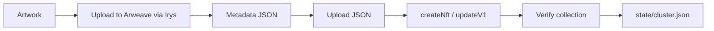

<div align="center">

# Solana NFT Creation Toolkit

**Create, mint, verify, update and inspect professional NFTs on Solana — with Metaplex Token Metadata, Umi and Arweave storage.**

[](LICENSE)
[](https://nodejs.org)
[](https://solana.com)
[](https://developers.metaplex.com/token-metadata)
[](skills/nft-creation/SKILL.md)


</div>

A small, typed, production-minded toolkit for launching NFT collections on
Solana. It replaces the usual copy-paste tutorial scripts with commands that
keep state, validate Metaplex limits, verify collections, and work on devnet,
mainnet and a local validator.

It also ships an [agent skill](skills/nft-creation/SKILL.md) so AI coding
agents can do the whole workflow correctly.

---

## Why this exists

Most Solana NFT tutorials stop at "it minted once". Real collections need:

- a collection NFT that actually contains its items,
- metadata that follows the Metaplex standard and fits on-chain limits,
- permanent storage (Arweave) instead of a temporary link,
- a safe update path that does not wipe attributes or royalties,
- a way to check what is really on-chain.

This repo covers those, with no hardcoded addresses and no silent mainnet
uploads.

## Features

- **Collection + items** — create a verified Metaplex collection and mint NFTs into it.
- **Automatic verification** — `create:nft` verifies membership by default; `verify` fixes existing mints.
- **State-aware CLI** — addresses are stored in `state/<cluster>.json`, so you never paste them between steps.
- **Safe updates** — preserves image, attributes and external URL when you only change the name.
- **Validation** — name (32 bytes), symbol (10), URI (200), royalty (0–10000 bps) checked before sending.
- **Arweave storage** — Irys uploader with the endpoint chosen from the cluster.
- **Inspect** — `show` prints on-chain data, collection verification and off-chain JSON.
- **Browser wallets** — `--signer browser` signs with Phantom, Solflare or Backpack; the key stays in the extension.
- **Local testing** — `test:e2e` runs the full flow against a local validator with no faucet.
- **AI agent skill** — a complete `SKILL.md` plus references for professional NFT work.

## Quickstart

### 1. Prerequisites

- Node.js 20+
- A Solana keypair (the toolkit can generate one)

### 2. Install

```bash
git clone --branch v2.0.0 --depth 1 https://github.com/devcodex2025/Creation-of-NFT-Solana.git
cd Creation-of-NFT-Solana
npm ci
cp .env.example .env
```

### 3. Create and fund a wallet

```bash
npm run keypair
npm run balance
```

For devnet, request SOL at [faucet.solana.com](https://faucet.solana.com).
For free, unlimited testing, run a local validator (see [Testing](#testing)).

### 4. Create a collection

```bash
npm run create:collection -- \
  --name "Lil Turtle Collection" \
  --symbol LIL \
  --description "A collection of cute lil turtle NFTs" \
  --image assets/lil_turtle_collection.webp \
  --royalty 2.5
```

The command uploads the image and metadata, mints the collection NFT, confirms
it on-chain and writes the address to `state/devnet.json`.

On Windows PowerShell, `npm run` drops the flags unless you add a second `--`.
Use the `npx esrun` form shown in [Passing flags on Windows
PowerShell](#passing-flags-on-windows-powershell).

### 5. Mint an NFT into it

```bash
npm run create:nft -- \
  --name "Lil Turtle #1" \
  --description "Small turtle with a big heart" \
  --image assets/lil_turtle.avif \
  --royalty 5
```

The collection address is read from state. The NFT is verified into the
collection automatically.

### 6. Check it

```bash
npm run show
```

```text
🔎  Lil Turtle #1 [LIL]
   Mint             : 3pDA3FzAG4eTH962AiULKvahXWdTUTe3jDBzMLkUNjRj
   Royalty          : 5%
   Mutable          : true
   Token standard   : NonFungible
   Collection       : FppUZdfNyjmSzMMUwhMu3pvmUSSmqYqwxEFtDK9p5zy5
   Verified         : true
   Attributes:
     • Background: Green
     • Eyes: Sleepy
```

That is the whole loop. Everything else is optional.

## Live example on devnet

Minted with this toolkit, metadata and art on Arweave:

| What | Address |
|---|---|
| Collection | [`4ALZXmgMxe5ii6WGVpCXyAXm9qCdYwKpvGCRpeMovqJX`](https://explorer.solana.com/address/4ALZXmgMxe5ii6WGVpCXyAXm9qCdYwKpvGCRpeMovqJX?cluster=devnet) |
| Item | [`28yf57a5AcSxoh3GcAa6hW6D3Jf8M6TVWze9TSUF4Tzv`](https://explorer.solana.com/address/28yf57a5AcSxoh3GcAa6hW6D3Jf8M6TVWze9TSUF4Tzv?cluster=devnet) |
| Metadata JSON | [gateway.irys.xyz](https://gateway.irys.xyz/6jjpGPrHo2XJyp9pkNym1tVve7uBTcdMJtUBkipGnmJH) |

The item carries `collection.verified = true` on chain, which is what puts it
inside the collection in wallets and marketplaces. Open the item in Explorer and
check the metadata account to see the flag yourself.

## Commands

| Command | What it does |
|---|---|
| `npm run keypair` | Generate `keypair.json` (refuses to overwrite) |
| `npm run balance` | Show SOL balance for the wallet or `--address` |
| `npm run fund -- --amount 5` | Airdrop on localnet/devnet when the faucet allows |
| `npm run create:collection` | Upload art + metadata and mint a collection NFT |
| `npm run create:nft` | Upload art + metadata and mint an NFT into the collection |
| `npm run verify` | Verify an existing NFT belongs to a collection |
| `npm run update` | Update metadata, image, royalty, authority or immutability |
| `npm run show` | Print on-chain + off-chain NFT details |
| `npm run test:e2e` | Full local end-to-end test |
| `npm run test:bridge` | Security checks for the local wallet bridge |
| `npm run typecheck` | TypeScript check |

Every command accepts `--help`-style flags documented below, and reads
configuration from `.env` or the environment. Two flags work on every command:

| Flag | Default | Notes |
|---|---|---|
| `--keypair` | `KEYPAIR_PATH` or `./keypair.json` | Keypair file to sign with |
| `--signer` | `SIGNER` or `keypair` | `keypair`, `browser` (Phantom/Solflare), `readonly` |

### Passing flags on Windows PowerShell

Windows PowerShell 7 with npm 11 eats the first `--` and treats `--flag` as npm
config, so `npm run create:nft -- --name "X"` reaches the script with no flags
and mints with defaults. Three ways around it, any of them correct:

```bash
# 1. Direct call, works in every shell
npx esrun src/commands/create-nft.ts --name "Lil Turtle #1" --royalty 5

# 2. Double separator under PowerShell
npm run create:nft -- -- --name "Lil Turtle #1" --royalty 5

# 3. cmd.exe or Git Bash
npm run create:nft -- --name "Lil Turtle #1" --royalty 5
```

The toolkit prints a warning when it receives no flags at all, so a silent
default mint is hard to miss.

### `create:collection`

| Flag | Default | Notes |
|---|---|---|
| `--name` | `Lil Turtle Collection` | Max 32 bytes on-chain |
| `--symbol` | `LIL` | Max 10 bytes |
| `--description` | sample text | Off-chain only |
| `--image` | `assets/lil_turtle_collection.webp` | png, jpg, webp, avif, gif, svg |
| `--external-url` | — | Marketplace "website" link |
| `--royalty` | `0` | Percent, e.g. `5` |
| `--royalty-bps` | — | Exact basis points, overrides `--royalty` |
| `--attributes` | from template | JSON array of traits |
| `--attributes-file` | — | JSON file containing an attribute array |
| `--json` | — | Metadata template, see `metadata/collection.example.json` |

### `create:nft`

| Flag | Default | Notes |
|---|---|---|
| `--name` | required | Max 32 bytes |
| `--symbol` | collection symbol | Max 10 bytes |
| `--description` | `""` | Off-chain only |
| `--image` | `assets/lil_turtle.avif` | Any supported image type |
| `--collection` | from state | Collection mint address |
| `--attributes` | — | JSON array (quote it carefully in PowerShell) |
| `--attributes-file` | — | JSON file containing an attribute array |
| `--json` | — | Metadata template, see `metadata/nft.example.json` |
| `--royalty` | `0` | Percent |
| `--skip-verify` | off | Mint without verifying into the collection |

### `verify`

| Flag | Default | Notes |
|---|---|---|
| `--nft` | last minted NFT | NFT mint address |
| `--collection` | from state | Collection mint address |

### `update`

| Flag | Default | Notes |
|---|---|---|
| `--mint` | last minted NFT | NFT mint address |
| `--name`, `--symbol`, `--description` | current values | Only pass what changes |
| `--image` | current image | Uploads a new image |
| `--attributes` | current attributes | Replaces the trait list |
| `--attributes-file` | — | JSON file with the new trait list |
| `--royalty` / `--royalty-bps` | current royalty | |
| `--new-authority` | — | Transfer update authority |
| `--immutable` | off | **Permanent**: metadata can never change again |

### `show`

| Flag | Default |
|---|---|
| `--mint` | last minted NFT |

## How it works



1. **Upload** — the image is read, given a correct content type and uploaded.
2. **Metadata** — a Metaplex-compatible JSON document points at the image.
3. **Mint** — `createNft` from `@metaplex-foundation/mpl-token-metadata` creates
   the mint, token account and metadata account.
4. **Verify** — `verifyCollectionV1` proves the collection's update authority
   approved the item. Marketplaces use this flag.
5. **Record** — the address and signature go to `state/<cluster>.json` so the
   next command can find them.

On-chain accounts and what they cost:

| Account | Rent (approx.) | Recoverable? |
|---|---|---|
| Mint | ~0.0015 SOL | Only by closing the mint |
| Metadata | ~0.012 SOL | Only by burning the NFT |
| Token account | ~0.002 SOL | Only by closing it |
| Transaction fees | ~0.000005 SOL per tx | No |

These are the only costs. Every one of them is paid on chain from your wallet to
Solana and to the storage network. The toolkit takes no fee of its own, adds no
markup, and holds no funds at any point.

## Project structure

```text
.
├── src/
│   ├── commands/          # one file per CLI command
│   │   ├── create-collection.ts
│   │   ├── create-nft.ts
│   │   ├── verify-collection.ts
│   │   ├── update-nft.ts
│   │   ├── show-nft.ts
│   │   ├── keypair.ts
│   │   ├── balance.ts
│   │   └── fund.ts
│   └── lib/               # config, metadata rules, uploads, state
├── tests/e2e.localnet.ts  # full flow against a local validator
├── metadata/              # JSON templates for collections and items
├── assets/                # sample artwork
├── skills/nft-creation/   # installable AI agent skill
├── docs/                  # architecture and troubleshooting
└── state/                 # generated per-cluster addresses (gitignored)
```

See [docs/ARCHITECTURE.md](docs/ARCHITECTURE.md) for the module map.

## Configuration

`.env` (see `.env.example`):

| Variable | Default | Purpose |
|---|---|---|
| `SOLANA_CLUSTER` | `devnet` | `devnet`, `testnet`, `mainnet-beta`, `localnet` |
| `RPC_URL` | cluster default | Custom RPC endpoint |
| `KEYPAIR_PATH` | `./keypair.json` | Keypair JSON path |
| `SIGNER` | `keypair` | `keypair`, `browser` (Phantom/Solflare), `readonly` |
| `STORAGE` | `irys` | `irys` (Arweave) or `local` (dev only) |
| `IRYS_ADDRESS` | per cluster | Override the Irys bundler |
| `STATE_DIR` | `./state` | Where addresses are stored |

### Which wallet pays

By default the CLI signs locally with a keypair file, and that same wallet pays
rent, transaction fees and storage inside each transaction. Resolution order:

1. `--keypair <path>` on the command,
2. `KEYPAIR_PATH` in `.env`,
3. `./keypair.json`,
4. `~/.config/solana/id.json` (the Solana CLI default).

An explicit `--keypair` or `KEYPAIR_PATH` that does not exist is an error. The
toolkit refuses to fall back to another wallet, so fees never come from an
account you did not choose.

```bash
npx esrun src/commands/create-nft.ts --keypair ./wallets/mint.json --name "Lil Turtle #1"
```

Use a dedicated mint wallet holding only what the launch needs. A keypair file
gives full control of the account to anyone who reads it.

Mainnet checklist before switching `SOLANA_CLUSTER=mainnet-beta`:

- fund the wallet with real SOL,
- test the exact metadata on devnet first,
- back up the keypair,
- decide who keeps the update authority,
- read [the launch checklist](skills/nft-creation/references/launch-checklist.md).

### Signing with Phantom or Solflare

If you would rather keep the key inside a browser extension, pass
`--signer browser`. The CLI starts a one-page server on `127.0.0.1`, opens it,
and asks the page to sign:

```bash
npx esrun src/commands/create-nft.ts --signer browser --name "Lil Turtle #1" --royalty 5
```

1. The page detects Phantom, Solflare or Backpack through Wallet Standard.
2. You press **Connect wallet** and pick the account.
3. Every transaction the CLI needs is shown in the extension for approval.
4. The signature returns to the CLI; the key never leaves the extension.

One mint needs two or three approvals: the Irys upload messages, the mint
transaction, and the collection verification transaction. Nothing is signed
silently, so this mode is for a human at the keyboard — an autonomous agent
cannot approve for you.

The bridge is loopback only. It listens on `127.0.0.1` with a random port, a
fresh 32-byte token per run, a `Host` header check, no cross-origin requests, and
it shuts down when the command finishes or after three minutes.
`npm run test:bridge` covers those properties.

`--signer readonly` builds a read-only client for commands that never sign
(`show`). `balance --signer browser` connects, reads the address, and closes the
bridge without signing anything.

## Metadata

The on-chain metadata is small; everything else lives in the JSON document.
Example:

```json
{
  "name": "Lil Turtle #1",
  "symbol": "LIL",
  "description": "Small turtle with a big heart",
  "image": "https://arweave.net/...",
  "external_url": "https://example.com",
  "attributes": [
    { "trait_type": "Background", "value": "Green" },
    { "trait_type": "Eyes", "value": "Sleepy" }
  ],
  "properties": {
    "files": [{ "uri": "https://arweave.net/...", "type": "image/avif" }],
    "category": "image"
  }
}
```

Hard limits enforced by the CLI:

| Field | Limit |
|---|---|
| Name | 32 bytes UTF-8 |
| Symbol | 10 bytes UTF-8 |
| URI | 200 bytes |
| Royalty | 0–10000 basis points |

Full schema and examples: [metadata standard](skills/nft-creation/references/metadata-standard.md).

## Testing

The end-to-end test needs a validator with the Token Metadata program. The
public devnet faucet is rate-limited, so local is the reliable option:

```bash
solana-test-validator --reset \
  --clone-upgradeable-program metaqbxxUerdq28cj1RbAWkYQm3ybzjb6a8bt518x1s
```

In a second terminal:

```bash
export SOLANA_CLUSTER=localnet
export RPC_URL=http://127.0.0.1:8899
npm run fund -- --amount 5
STORAGE=local npm run test:e2e
```

The test creates a collection, mints an NFT, verifies it, updates it, verifies
an unverified mint, and asserts the validation guardrails. If the validator
does not have Token Metadata cloned you will see
`Attempt to load a program that does not exist`.

## AI agent skill

[`skills/nft-creation`](skills/nft-creation/SKILL.md) teaches an agent the whole
workflow: choosing a token standard, writing metadata, uploading to Arweave,
verifying collections, royalties, launch checks and error handling.

Install with the [skills CLI](https://www.skills.sh/):

```bash
npx skills add https://github.com/devcodex2025/Creation-of-NFT-Solana/tree/v2.0.0/skills/nft-creation
```

Or copy `skills/nft-creation/` into your agent's skills directory:

| Agent | Personal directory |
|---|---|
| OpenCode | `~/.config/opencode/skills/` |
| Claude Code | `~/.claude/skills/` |
| Codex / ChatGPT desktop | `~/.agents/skills/` |
| Cursor | `~/.cursor/skills/` |
| Gemini CLI | `~/.gemini/skills/` |

## Troubleshooting

| Symptom | Cause | Fix |
|---|---|---|
| `Attempt to load a program that does not exist` | Local validator without Token Metadata | Add `--clone-upgradeable-program metaqbxx...` |
| `410 Gone` on airdrop | Public devnet faucet disabled | Use faucet.solana.com or localnet |
| `Not the update authority` | Wrong keypair | Use the collection's update authority |
| `Verified: false` after mint | Collection authority differs | Run `verify` with the collection authority |
| `Name is N bytes` | UTF-8 limit | Shorten the name |
| `Collection ... was not found` | State points at an old ledger | Re-create the collection or pass `--collection` |
| `insufficient funds for rent` | Wallet below ~0.02 SOL | Fund the wallet |
| Irys upload hangs | Network/funding | Check balance, retry, or use `STORAGE=local` locally |

More: [docs/TROUBLESHOOTING.md](docs/TROUBLESHOOTING.md).

## Security

- Never commit `keypair.json` or `.env`.
- The update authority can rewrite metadata and royalties. Protect it.
- Immutability is irreversible. `--immutable` is a one-way door.
- Read [SECURITY.md](SECURITY.md) before a mainnet launch.

## Contributing

Issues and PRs are welcome. See [CONTRIBUTING.md](CONTRIBUTING.md) and
[CHANGELOG.md](CHANGELOG.md).

## License

MIT — see [LICENSE](LICENSE).
